<!-- i18n-source: README.md@80ba9c903424f2df7f4502c7f0fcfb1759126c62 status=reviewed -->
<!-- brand:start -->

<p align="center"><picture><source media="(prefers-color-scheme: dark)" srcset="https://raw.githubusercontent.com/muhittincamdali/iOSAppTemplates/master/.github/brand/banner-es-dark.svg"><source media="(prefers-color-scheme: light)" srcset="https://raw.githubusercontent.com/muhittincamdali/iOSAppTemplates/master/.github/brand/banner-es-light.svg"></picture></p>

<!-- lang-selector:start -->
<p align="center"><a href="README.md">English</a> · <a href="README.tr.md">Türkçe</a> · <a href="README.zh-CN.md">简体中文</a> · <a href="README.ja.md">日本語</a> · <a href="README.ko.md">한국어</a> · <a href="README.es.md">Español</a> · <a href="README.de.md">Deutsch</a> · <a href="README.fr.md">Français</a> · <a href="README.pt-BR.md">Português (Brasil)</a> · <a href="README.ru.md">Русский</a></p>
<!-- lang-selector:end -->

<p align="center">
<a href="https://github.com/muhittincamdali/iOSAppTemplates/actions/workflows/ci.yml"></a>
<a href="https://github.com/muhittincamdali/iOSAppTemplates/releases"><picture><source media="(prefers-color-scheme: dark)" srcset="https://raw.githubusercontent.com/muhittincamdali/iOSAppTemplates/master/.github/brand/badge-version-dark.svg"><source media="(prefers-color-scheme: light)" srcset="https://raw.githubusercontent.com/muhittincamdali/iOSAppTemplates/master/.github/brand/badge-version-light.svg"></picture></a>
<a href="https://github.com/muhittincamdali/iOSAppTemplates/blob/master/Package.swift"><picture><source media="(prefers-color-scheme: dark)" srcset="https://raw.githubusercontent.com/muhittincamdali/iOSAppTemplates/master/.github/brand/badge-platforms-dark.svg"><source media="(prefers-color-scheme: light)" srcset="https://raw.githubusercontent.com/muhittincamdali/iOSAppTemplates/master/.github/brand/badge-platforms-light.svg"></picture></a>
<a href="https://github.com/muhittincamdali/iOSAppTemplates/blob/master/Package.swift"><picture><source media="(prefers-color-scheme: dark)" srcset="https://raw.githubusercontent.com/muhittincamdali/iOSAppTemplates/master/.github/brand/badge-language-dark.svg"><source media="(prefers-color-scheme: light)" srcset="https://raw.githubusercontent.com/muhittincamdali/iOSAppTemplates/master/.github/brand/badge-language-light.svg"></picture></a>
<a href="https://github.com/muhittincamdali/iOSAppTemplates/blob/master/LICENSE"><picture><source media="(prefers-color-scheme: dark)" srcset="https://raw.githubusercontent.com/muhittincamdali/iOSAppTemplates/master/.github/brand/badge-license-dark.svg"><source media="(prefers-color-scheme: light)" srcset="https://raw.githubusercontent.com/muhittincamdali/iOSAppTemplates/master/.github/brand/badge-license-light.svg"></picture></a>
<a href="https://github.com/muhittincamdali/iOSAppTemplates/tree/master/Templates"><picture><source media="(prefers-color-scheme: dark)" srcset="https://raw.githubusercontent.com/muhittincamdali/iOSAppTemplates/master/.github/brand/badge-templates-dark.svg"><source media="(prefers-color-scheme: light)" srcset="https://raw.githubusercontent.com/muhittincamdali/iOSAppTemplates/master/.github/brand/badge-templates-light.svg"></picture></a>
</p>

<p align="center">
<a href="#inicio-rápido"><picture><source media="(prefers-color-scheme: dark)" srcset="https://raw.githubusercontent.com/muhittincamdali/iOSAppTemplates/master/.github/brand/button-start-es-dark.svg"><source media="(prefers-color-scheme: light)" srcset="https://raw.githubusercontent.com/muhittincamdali/iOSAppTemplates/master/.github/brand/button-start-es-light.svg"></picture></a>
<a href="https://muhittincamdali.github.io/iOSAppTemplates/documentation/templatescaffold/"><picture><source media="(prefers-color-scheme: dark)" srcset="https://raw.githubusercontent.com/muhittincamdali/iOSAppTemplates/master/.github/brand/button-docs-es-dark.svg"><source media="(prefers-color-scheme: light)" srcset="https://raw.githubusercontent.com/muhittincamdali/iOSAppTemplates/master/.github/brand/button-docs-es-light.svg"></picture></a>
<a href="https://github.com/muhittincamdali/iOSAppTemplates/tree/master/Examples"><picture><source media="(prefers-color-scheme: dark)" srcset="https://raw.githubusercontent.com/muhittincamdali/iOSAppTemplates/master/.github/brand/button-examples-es-dark.svg"><source media="(prefers-color-scheme: light)" srcset="https://raw.githubusercontent.com/muhittincamdali/iOSAppTemplates/master/.github/brand/button-examples-es-light.svg"></picture></a>
</p>

> Esta es una traducción del README en inglés. Si hay diferencias, la versión en inglés es la vigente.

<!-- brand:end -->

Veinte plantillas de apps SwiftUI para iOS 18, desde comercio electrónico y finanzas hasta
mensajería y viajes. Cada plantilla es un paquete Swift independiente con una app basada en
pestañas, datos de ejemplo y un store con tests. Añade una a un proyecto de app en Xcode para
verla funcionar, o cópiala con tu propio nombre usando `create-ios-app` y construye tu app a partir
de ella.

Las plantillas son puntos de partida, no productos terminados: todas las pantallas funcionan con
datos de ejemplo en memoria y no hay capa de red ni base de datos. Lo que te dan es una estructura
de pestañas que funciona, la navegación y, en cada app, un store con tests que puedes conectar a tus
propios servicios.

## Lo más destacado

- **Veinte tipos de app**: asistente de IA, reservas, vídeo corto para creadores, CRM, comercio
  electrónico, educación, finanzas personales, fitness, comida a domicilio, marketplace, mensajería,
  música y pódcasts, noticias, notas, bóveda de privacidad, productividad, redes sociales,
  suscripciones, colaboración en equipo y viajes.
- **Un store con tests en cada app**: el estado y las acciones están en un store `@MainActor` con
  una suite de Swift Testing, así que las pantallas se mantienen simples y el comportamiento se
  comprueba sin interfaz.
- **Sin dependencias de terceros**: las plantillas solo usan SwiftUI y Foundation, y funcionan sin
  cuenta, sin clave de API y sin acceso a la red.
- **Con tu propio nombre**: `create-ios-app` renombra el paquete, el módulo, los tipos, el proyecto
  anfitrión y el bundle identifier, y rechaza nombres que chocarían con nombres de la plantilla.
- **Claro y oscuro**: cada plantilla tiene capturas de las dos apariencias, tomadas en el simulador
  por un script de este repositorio.

## Inicio rápido

**1. Descarga las plantillas**

```sh
git clone https://github.com/muhittincamdali/iOSAppTemplates.git
```

**2. Añade una plantilla a tu app**

En Xcode, crea una app con **File › New › Project… › iOS › App** (o abre la tuya; su deployment
target debe ser iOS 18 o posterior). Elige **File › Add Package Dependencies…**, haz clic en
**Add Local…**, selecciona la carpeta `iOSAppTemplates/Templates/EcommerceApp` y haz clic en
**Add Package**. Añade la biblioteca `EcommerceApp` al target de tu app.

**3. Ejecútala**

Sustituye el contenido del archivo que contiene `@main` (en un proyecto nuevo, el que lleva el
nombre de tu app, como `MyAppApp.swift`) por:

```swift
import EcommerceApp

@main
enum QuickStartApp {
    static func main() {
        EcommerceAppShell.main()
    }
}
```

Elige un simulador de iPhone y pulsa **Run** (⌘R). Aparece la pestaña Shop de la plantilla
E-commerce. El proyecto terminado está en [Examples/QuickStart](Examples/QuickStart).

## Instalación

### Plantillas

Añade una carpeta de `Templates/` a tu app como paquete local, como en el inicio rápido, o crea una
copia renombrada con `create-ios-app` (consulta [Uso](#uso)). Las plantillas no se publican como
paquetes remotos, porque cada una está pensada para copiarse y modificarse.

### create-ios-app

Ejecuta la herramienta desde un clon con `swift run create-ios-app`, o compílala una vez y ejecuta
el binario:

```sh
swift build -c release
.build/release/create-ios-app list
```

### Biblioteca TemplateScaffold

La lógica de `create-ios-app` está en la biblioteca `TemplateScaffold` (macOS 14 o posterior).
Todavía no forma parte de una versión etiquetada (la etiqueta `v2.1.0` tiene la estructura
anterior), así que depende de `master`:

```swift
dependencies: [
    .package(url: "https://github.com/muhittincamdali/iOSAppTemplates.git", branch: "master")
],
targets: [
    .executableTarget(name: "YourTool", dependencies: [
        .product(name: "TemplateScaffold", package: "iOSAppTemplates")
    ])
]
```

## Uso

### Elige una plantilla

Los nombres de las plantillas y de las pestañas aparecen tal como se ven en la app (en inglés).

| `--template` | Plantilla | Pestañas |
| ------------------------ | ------------------------------------------------------------ | ------------------------------------------------ |
| `ai-assistant`           | [AI Assistant](Templates/AIAssistantApp)                     | Workspace, Presets, Memory, Tools, Trust         |
| `booking`                | [Booking & Reservations](Templates/BookingReservationsApp)   | Home, Calendar, Guests, Requests, Profile        |
| `creator-video`          | [Creator Short Video](Templates/CreatorShortVideoApp)        | Studio, Pipeline, Analytics, Moderation, Profile |
| `crm`                    | [CRM Admin](Templates/CRMAdminApp)                           | Pipeline, Accounts, Renewals, Tasks, Profile     |
| `ecommerce`              | [E-commerce](Templates/EcommerceApp)                         | Shop, Browse, Cart, Orders, Profile              |
| `education`              | [Education](Templates/EducationApp)                          | Home, Courses, Lessons, Assessments, Progress    |
| `finance`                | [Personal Finance](Templates/FinanceApp)                     | Overview, Accounts, Budgets, Activity, Insights  |
| `fitness`                | [Fitness](Templates/FitnessApp)                              | Plan, Session, Progress, Recovery, Profile       |
| `food-delivery`          | [Food Delivery](Templates/FoodDeliveryApp)                   | Home, Browse, Cart, Orders, Profile              |
| `marketplace`            | [Marketplace](Templates/MarketplaceApp)                      | Home, Browse, Seller, Orders, Trust              |
| `messaging`              | [Messaging](Templates/MessagingApp)                          | Inbox, Rooms, Safety, Profile                    |
| `music-podcast`          | [Music & Podcasts](Templates/MusicPodcastApp)                | Library, Queue, Downloads, Discover, Profile     |
| `news-blog`              | [News & Blog](Templates/NewsBlogApp)                         | Today, Sections, Saved, Digest, Profile          |
| `notes`                  | [Notes & Knowledge](Templates/NotesKnowledgeApp)             | Capture, Library, Links, Spaces, Profile         |
| `privacy-vault`          | [Privacy Vault](Templates/PrivacyVaultApp)                   | Vault, Alerts, Recovery, Audit, Profile          |
| `productivity`           | [Productivity](Templates/ProductivityApp)                    | Dashboard, Inbox, Projects, Focus, Review        |
| `social`                 | [Social Media](Templates/SocialMediaApp)                     | Feed, Explore, Create, Notifications, Profile    |
| `subscription-lifestyle` | [Subscription Lifestyle](Templates/SubscriptionLifestyleApp) | Dashboard, Programs, Streaks, Plans, Profile     |
| `team-collaboration`     | [Team Collaboration](Templates/TeamCollaborationApp)         | Workspace, Tasks, Decisions, Handoffs, Profile   |
| `travel`                 | [Travel Planner](Templates/TravelPlannerApp)                 | Trips, Timeline, Bookings, Essentials, Profile   |

`SocialMediaApp` también muestra cómo poner un límite delante de un proveedor de identidad: el
inicio de sesión pasa por un protocolo `AuthService`, y el `LocalAuthService` incluido guarda las
cuentas en memoria con una cuenta de demostración (`demo@example.com` / `password123`).

### Crea un proyecto con tu propio nombre

```bash
cd iOSAppTemplates
swift run create-ios-app list
swift run create-ios-app new MyShop --template ecommerce --output ~/Developer
```

La herramienta copia `Templates/EcommerceApp` en `~/Developer/MyShop` y renombra el paquete, el
módulo, el target de tests, `EcommerceAppShell`, el proyecto anfitrión y el bundle identifier para
que usen `MyShop`. Los nombres deben ser identificadores de Swift que empiecen por una letra ASCII.
La herramienta no sobrescribe un directorio existente y rechaza nombres que se convertirían en un
nombre que la plantilla ya usa, como `CommerceStore` en la plantilla E-commerce.

Añade `~/Developer/MyShop` a tu app como en el inicio rápido (`import MyShop`,
`MyShopShell.main()`), o ejecuta sus tests y abre su proyecto anfitrión:

```bash
cd ~/Developer/MyShop
xcodebuild test -scheme MyShop -destination 'platform=iOS Simulator,name=iPhone 17'

cd App
xcodegen generate
open MyShop.xcodeproj
```

`iPhone 17` es solo un ejemplo; usa cualquier simulador que aparezca en
`xcrun simctl list devices available`. El proyecto anfitrión necesita
[XcodeGen](https://github.com/yonaskolb/XcodeGen) (`brew install xcodegen`).

### Trabaja en una plantilla directamente

Abre `Templates/<Name>/Package.swift` en Xcode para editar la plantilla y ejecutar sus tests, o
genera su proyecto anfitrión desde `Templates/<Name>/App` con `xcodegen generate`.

### Usa la biblioteca de scaffolding

`TemplateScaffold` necesita una copia local de este repositorio, porque las plantillas se leen de
`Templates/`:

```swift
import Foundation
import TemplateScaffold

func makeShop(templates: URL, output: URL) throws -> ScaffoldResult {
    guard let template = TemplateCatalog.template(named: "ecommerce") else {
        throw CocoaError(.fileNoSuchFile)
    }
    let name = try ProjectName("MyShop")
    return try Scaffolder(templatesDirectory: templates).scaffold(template, as: name, in: output)
}
```

La suite de tests compila y ejecuta este fragmento.

## Demo

La primera pantalla de cada plantilla; las versiones clara y oscura están en
[docs/images](docs/images):

| AI Assistant                                                                             | Booking & Reservations                                                                                       | Creator Short Video                                                                                   | CRM Admin                                                                          | E-commerce                                                                           |
| ---------------------------------------------------------------------------------------- | ------------------------------------------------------------------------------------------------------------ | ----------------------------------------------------------------------------------------------------- | ---------------------------------------------------------------------------------- | ------------------------------------------------------------------------------------ |
| 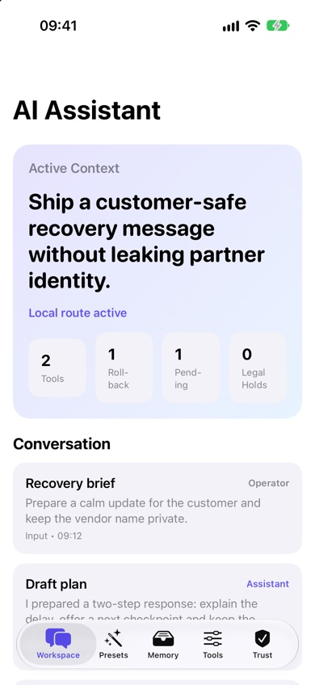 | 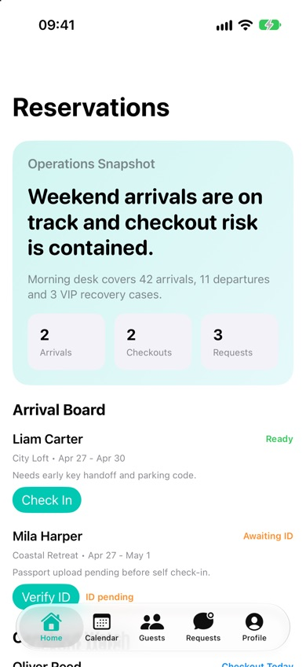 | 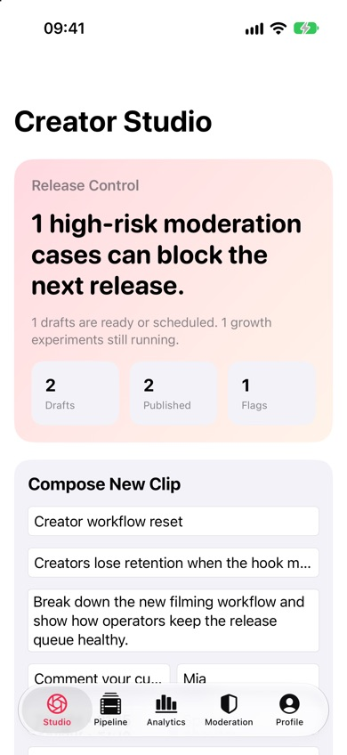 | 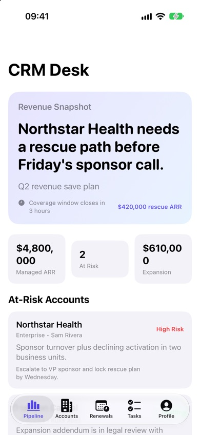 | 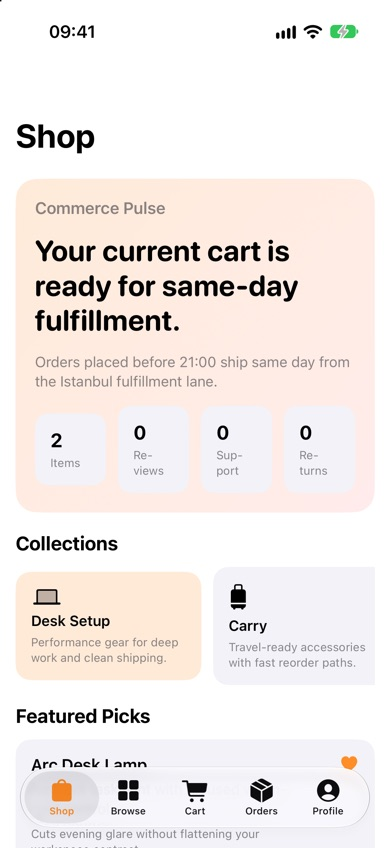 |

| Education                                                                           | Personal Finance                                                                         | Fitness                                                                         | Food Delivery                                                                              | Marketplace                                                                             |
| ----------------------------------------------------------------------------------- | ---------------------------------------------------------------------------------------- | ------------------------------------------------------------------------------- | ------------------------------------------------------------------------------------------ | --------------------------------------------------------------------------------------- |
| 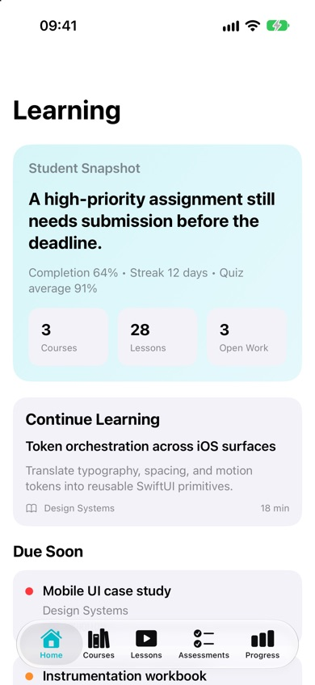 | 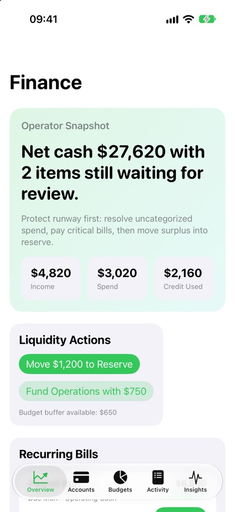 | 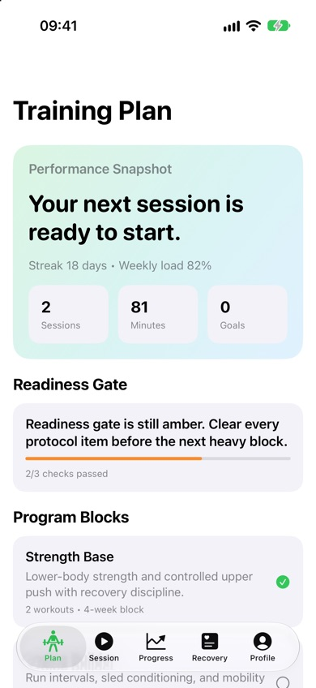 | 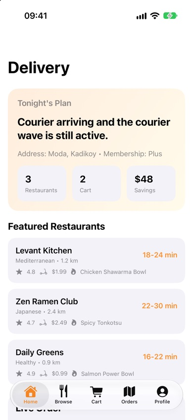 | 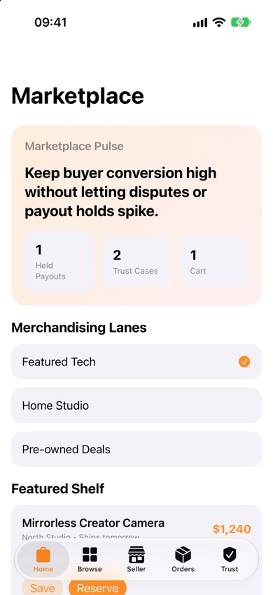 |

| Messaging                                                                                           | Music & Podcasts                                                                                                | News & Blog                                                                                            | Notes & Knowledge                                                                                                  | Privacy Vault                                                                                              |
| --------------------------------------------------------------------------------------------------- | --------------------------------------------------------------------------------------------------------------- | ------------------------------------------------------------------------------------------------------ | ------------------------------------------------------------------------------------------------------------------ | ---------------------------------------------------------------------------------------------------------- |
| 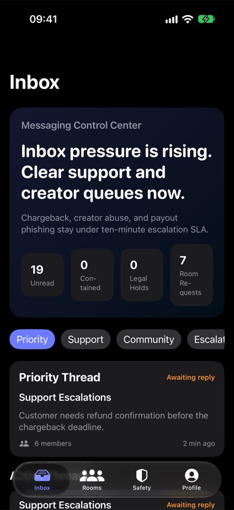 | 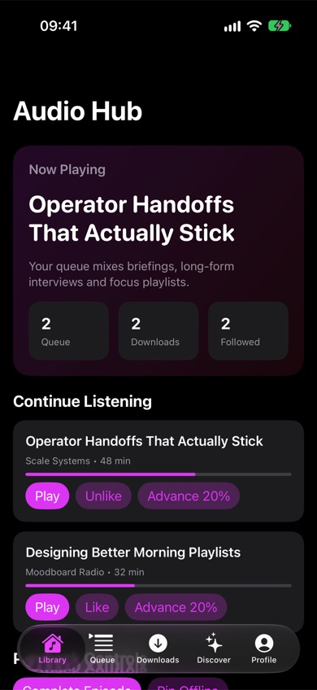 | 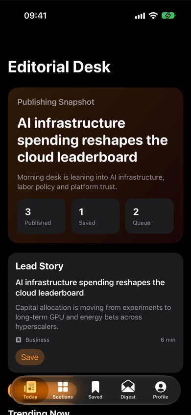 | 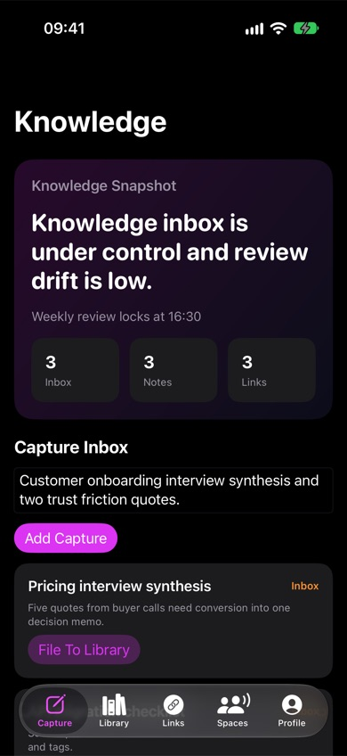 | 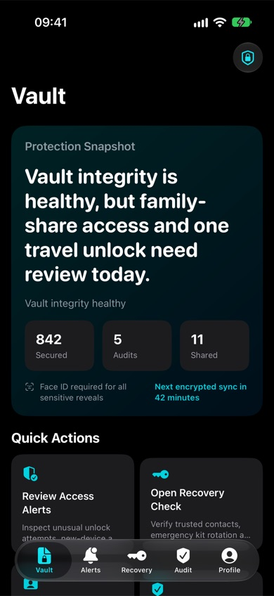 |

| Productivity                                                                                              | Social Media                                                                                             | Subscription Lifestyle                                                                                                       | Team Collaboration                                                                                                   | Travel Planner                                                                                               |
| --------------------------------------------------------------------------------------------------------- | -------------------------------------------------------------------------------------------------------- | ---------------------------------------------------------------------------------------------------------------------------- | -------------------------------------------------------------------------------------------------------------------- | ------------------------------------------------------------------------------------------------------------ |
| 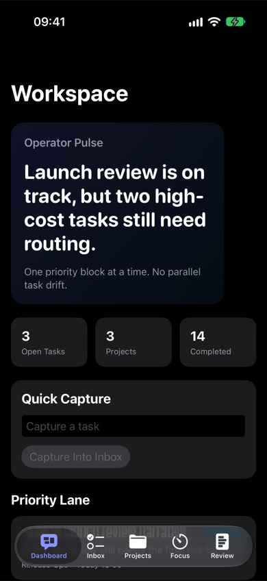 | 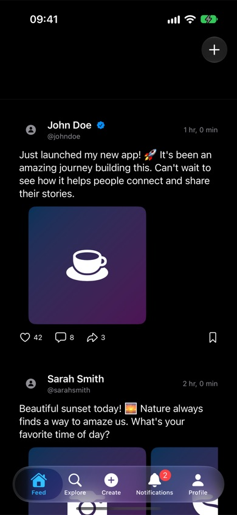 | 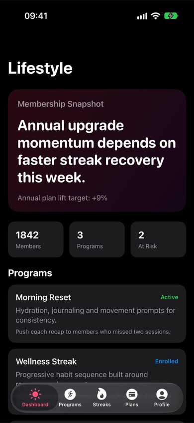 | 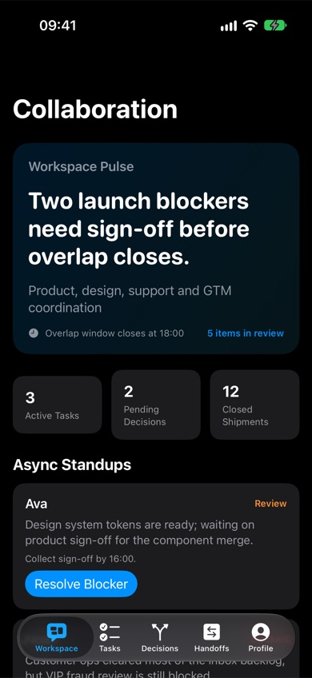 | 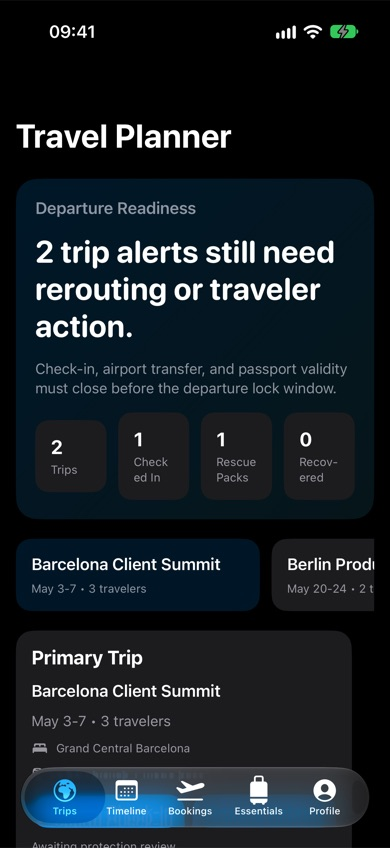 |

Las capturas se toman en un simulador de iPhone 17 Pro con
[scripts/capture-screenshots.sh](scripts/capture-screenshots.sh). Para ejecutar una plantilla tú
mismo, abre [Examples/QuickStart](Examples/QuickStart) en Xcode y pulsa **Run**.

## Documentación

Referencia de la API y artículos:

- [Documentación de TemplateScaffold en GitHub Pages](https://muhittincamdali.github.io/iOSAppTemplates/documentation/templatescaffold/):
  la API de la biblioteca de scaffolding y los artículos de abajo.
- Cada plantilla tiene en su carpeta un README con sus pantallas, su store y sus tests, por
  ejemplo [Templates/EcommerceApp](Templates/EcommerceApp).

Para generar la documentación en local:

```bash
swift package generate-documentation --target TemplateScaffold
```

## Guías

- [Getting Started](Sources/TemplateScaffold/TemplateScaffold.docc/GettingStarted.md): crea un
  proyecto con `create-ios-app`, ejecuta sus tests y ábrelo en Xcode.
- [Adding a Template to an App](Sources/TemplateScaffold/TemplateScaffold.docc/AddingATemplateToAnApp.md):
  el inicio rápido en detalle y qué cambiar después.
- [How Renaming Works](Sources/TemplateScaffold/TemplateScaffold.docc/HowRenamingWorks.md):
  qué nombres cambian, cuáles no y cuáles se rechazan.
- [Examples](Examples): la app QuickStart.

Las guías están en inglés.

## Requisitos

| Plataforma                               | Versión mínima            |
| ---------------------------------------- | ------------------------- |
| iOS (plantillas)                         | 18.0                      |
| macOS (create-ios-app, TemplateScaffold) | 14.0                      |
| Herramientas                             | Swift 6.0 (tools version) |

El código se compila y se prueba con Xcode 27.0 (Swift 6.4); la CI usa el Xcode predeterminado de
la imagen `macos-26` de GitHub. XcodeGen solo hace falta para los proyectos anfitriones de
`Templates/<Name>/App`.

## Arquitectura

```text
Package.swift                 create-ios-app + TemplateScaffold (macOS)
Sources/CLI/                  argument parsing (swift-argument-parser)
Sources/TemplateScaffold/     catalog, name validation, renaming, copying
Tests/TemplateScaffoldTests/  Swift Testing, including a scaffold of every template
Templates/<Name>/             20 independent iOS 18 packages with tests and an App/ host
Examples/QuickStart/          an app project that runs a template as a local package
scripts/                      test-templates.sh, capture-screenshots.sh
```

Cada plantilla contiene:

- `Sources/<Name>/`: la escena pública `<Name>Shell`, las pantallas y un store `@MainActor`
  `ObservableObject` que contiene los datos de ejemplo y todas las acciones que lanzan las
  pantallas (totales del carrito, transiciones de estado de pedidos y reservas, colas de
  aprobación, etc.). La mayoría de las plantillas lo tiene en `<Name>.swift`; `EcommerceApp`,
  `FitnessApp` y `SocialMediaApp` separan el store, los modelos y las pantallas en archivos
  distintos.
- `Tests/<Name>Tests/`: una suite de Swift Testing para ese store que cubre valores derivados,
  transiciones de estado, cláusulas guard para entradas no válidas e identificadores desconocidos,
  y límites que no deben superarse.
- `App/`: una especificación de XcodeGen y un archivo anfitrión que llama a `<Name>Shell.main()`.

Las plantillas no dependen del paquete raíz ni entre sí. El renombrado es una sustitución de texto
del nombre del directorio de la plantilla; por eso todos los nombres que deben cambiar empiezan por
él (`EcommerceApp`, `EcommerceAppShell`, `EcommerceAppTests`).

## Hoja de ruta

- Publicar la estructura actual como 3.0.0 con notas de versión y añadir el paquete al Swift
  Package Index.
- Sustituir por enums los estados basados en texto que quedan, como el titular del pedido en
  `EcommerceApp`, el estado de contención en `MessagingApp` y el modo de preset en
  `AIAssistantApp`.
- Dividir las plantillas que todavía tienen casi todo su código en `<Name>.swift` en archivos de
  store, modelos y pantallas, como ya hacen `EcommerceApp`, `FitnessApp` y `SocialMediaApp`.

## Contribuir

Las contribuciones son bienvenidas. Lee la [guía de contribución](CONTRIBUTING.md) y el
[código de conducta](https://github.com/muhittincamdali/.github/blob/main/CODE_OF_CONDUCT.md) antes
de abrir una pull request. Informa de los problemas de seguridad de forma privada, como se describe
en la [política de seguridad](SECURITY.md). Los cambios se registran en
[CHANGELOG.md](CHANGELOG.md).

```bash
swift test                                   # scaffolding library and CLI
scripts/test-templates.sh                    # all templates in the iOS Simulator
scripts/test-templates.sh EcommerceApp       # one template
scripts/capture-screenshots.sh               # refresh docs/images
```

## Licencia

Publicado bajo la licencia MIT. Consulta [LICENSE](LICENSE).
