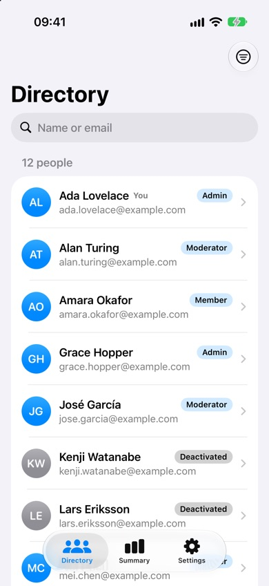
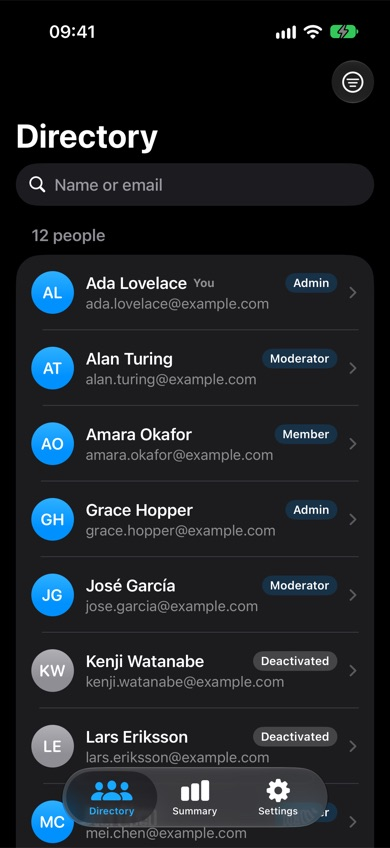

<!-- i18n-source: README.md@eed94fcb5366016b592c2a744777b343f1322349 status=reviewed -->
<!-- brand:start -->

<p align="center"><picture><source media="(prefers-color-scheme: dark)" srcset="https://raw.githubusercontent.com/muhittincamdali/iOSAppTemplates/master/.github/brand/banner-tr-dark.svg"><source media="(prefers-color-scheme: light)" srcset="https://raw.githubusercontent.com/muhittincamdali/iOSAppTemplates/master/.github/brand/banner-tr-light.svg"></picture></p>

<!-- lang-selector:start -->
<p align="center"><a href="README.md">English</a> · <a href="README.tr.md">Türkçe</a> · <a href="README.zh-CN.md">简体中文</a> · <a href="README.ja.md">日本語</a> · <a href="README.ko.md">한국어</a> · <a href="README.es.md">Español</a> · <a href="README.de.md">Deutsch</a> · <a href="README.fr.md">Français</a> · <a href="README.pt-BR.md">Português (Brasil)</a> · <a href="README.ru.md">Русский</a></p>
<!-- lang-selector:end -->

<p align="center">
<a href="https://github.com/muhittincamdali/iOSAppTemplates/actions/workflows/ci.yml"></a>
<a href="https://github.com/muhittincamdali/iOSAppTemplates/releases"><picture><source media="(prefers-color-scheme: dark)" srcset="https://raw.githubusercontent.com/muhittincamdali/iOSAppTemplates/master/.github/brand/badge-version-dark.svg"><source media="(prefers-color-scheme: light)" srcset="https://raw.githubusercontent.com/muhittincamdali/iOSAppTemplates/master/.github/brand/badge-version-light.svg"></picture></a>
<a href="https://github.com/muhittincamdali/iOSAppTemplates/blob/master/Package.swift"><picture><source media="(prefers-color-scheme: dark)" srcset="https://raw.githubusercontent.com/muhittincamdali/iOSAppTemplates/master/.github/brand/badge-platforms-dark.svg"><source media="(prefers-color-scheme: light)" srcset="https://raw.githubusercontent.com/muhittincamdali/iOSAppTemplates/master/.github/brand/badge-platforms-light.svg"></picture></a>
<a href="https://github.com/muhittincamdali/iOSAppTemplates/blob/master/Package.swift"><picture><source media="(prefers-color-scheme: dark)" srcset="https://raw.githubusercontent.com/muhittincamdali/iOSAppTemplates/master/.github/brand/badge-language-dark.svg"><source media="(prefers-color-scheme: light)" srcset="https://raw.githubusercontent.com/muhittincamdali/iOSAppTemplates/master/.github/brand/badge-language-light.svg"></picture></a>
<a href="https://github.com/muhittincamdali/iOSAppTemplates/blob/master/LICENSE"><picture><source media="(prefers-color-scheme: dark)" srcset="https://raw.githubusercontent.com/muhittincamdali/iOSAppTemplates/master/.github/brand/badge-license-dark.svg"><source media="(prefers-color-scheme: light)" srcset="https://raw.githubusercontent.com/muhittincamdali/iOSAppTemplates/master/.github/brand/badge-license-light.svg"></picture></a>
<a href="https://github.com/muhittincamdali/iOSAppTemplates/tree/master/Templates"><picture><source media="(prefers-color-scheme: dark)" srcset="https://raw.githubusercontent.com/muhittincamdali/iOSAppTemplates/master/.github/brand/badge-templates-dark.svg"><source media="(prefers-color-scheme: light)" srcset="https://raw.githubusercontent.com/muhittincamdali/iOSAppTemplates/master/.github/brand/badge-templates-light.svg"></picture></a>
</p>

<p align="center">
<a href="#hızlı-başlangıç"><picture><source media="(prefers-color-scheme: dark)" srcset="https://raw.githubusercontent.com/muhittincamdali/iOSAppTemplates/master/.github/brand/button-start-tr-dark.svg"><source media="(prefers-color-scheme: light)" srcset="https://raw.githubusercontent.com/muhittincamdali/iOSAppTemplates/master/.github/brand/button-start-tr-light.svg"></picture></a>
<a href="https://muhittincamdali.github.io/iOSAppTemplates/documentation/templatescaffold/"><picture><source media="(prefers-color-scheme: dark)" srcset="https://raw.githubusercontent.com/muhittincamdali/iOSAppTemplates/master/.github/brand/button-docs-tr-dark.svg"><source media="(prefers-color-scheme: light)" srcset="https://raw.githubusercontent.com/muhittincamdali/iOSAppTemplates/master/.github/brand/button-docs-tr-light.svg"></picture></a>
<a href="https://github.com/muhittincamdali/iOSAppTemplates/tree/master/Examples"><picture><source media="(prefers-color-scheme: dark)" srcset="https://raw.githubusercontent.com/muhittincamdali/iOSAppTemplates/master/.github/brand/button-examples-tr-dark.svg"><source media="(prefers-color-scheme: light)" srcset="https://raw.githubusercontent.com/muhittincamdali/iOSAppTemplates/master/.github/brand/button-examples-tr-light.svg"></picture></a>
</p>

> Bu belge İngilizce README'nin çevirisidir. İkisi arasında fark varsa güncel olan İngilizce sürümdür.

<!-- brand:end -->

iOS 18 için e-ticaretten finansa, mesajlaşmadan seyahate yirmi bir SwiftUI uygulama şablonu. Her
şablon; sekmeli bir uygulama, örnek veriler ve testler içeren bağımsız bir Swift paketidir.
Çalıştığını görmek için birini Xcode'da bir uygulama projesine ekleyin ya da `create-ios-app` ile
kendi adınızla kopyalayıp uygulamanızı onun üzerine kurun.

Şablonlar bitmiş ürün değil, başlangıç noktasıdır. Bunların yirmisi bellekteki örnek verilerle
çalışır; size çalışan bir sekme yapısı, navigasyon ve kendi servislerinize bağlayabileceğiniz,
testli bir store verir. Clean Architecture şablonu bir adım daha ileri gider: Domain, Data ve
Presentation hedefleri, süreç içi bir örnek sunucuyla çalışan bir HTTP katmanı ve çevrimdışı bir
önbellek.

## Öne çıkanlar

- **Yirmi uygulama türü**: yapay zekâ asistanı, rezervasyon, içerik üreticisi videosu, CRM,
  e-ticaret, eğitim, finans, fitness, yemek siparişi, pazar yeri, mesajlaşma, müzik ve podcast,
  haber, notlar, gizlilik kasası, verimlilik, sosyal medya, abonelik, ekip çalışması ve seyahat.
- **Katmanlı bir referans uygulama**: `CleanArchitectureApp`, katmanları ayrı hedefler olan bir ekip
  dizinidir; bu yüzden bağımlılık kuralını derleyici zorunlu kılar. Kişileri HTTP üzerinden yükler,
  çevrimdışıyken kayıtlı kopyaya döner, rolleri ve izinleri use case'lerde denetler; dört hedefte 108
  test ve erişilebilirlik denetimi içeren UI testleri vardır.
- **Her uygulamada testli bir store**: durum ve eylemler, Swift Testing paketi olan bir
  `@MainActor` store'da tutulur; böylece ekranlar sade kalır ve davranış arayüz olmadan test
  edilir.
- **Üçüncü taraf bağımlılık yok**: şablonlar yalnızca SwiftUI ve Foundation kullanır; hesap, API
  anahtarı ya da ağ erişimi olmadan çalışır.
- **Kendi adınız**: `create-ios-app` paketi, modülü, türleri, host projesini ve bundle
  identifier'ı yeniden adlandırır; şablondaki bir adla çakışacak adları reddeder.
- **Açık ve koyu görünüm**: her şablonun iki görünümde de ekran görüntüsü vardır; bunlar bu
  depodaki bir betikle simülatörde alınır.

## Hızlı başlangıç

**1. Şablonları indirin**

```sh
git clone https://github.com/muhittincamdali/iOSAppTemplates.git
```

**2. Uygulamanıza bir şablon ekleyin**

Xcode'da **File › New › Project… › iOS › App** ile bir uygulama oluşturun (ya da kendi
uygulamanızı açın; deployment target iOS 18 veya üstü olmalı). **File › Add Package
Dependencies…** menüsünü seçin, **Add Local…** düğmesine tıklayın,
`iOSAppTemplates/Templates/EcommerceApp` klasörünü seçin ve **Add Package**'e tıklayın.
`EcommerceApp` kütüphanesini uygulama hedefinize ekleyin.

**3. Çalıştırın**

`@main` içeren dosyanın (yeni bir projede uygulamanızın adını taşıyan dosya, örneğin
`MyAppApp.swift`) içeriğini şununla değiştirin:

```swift
import EcommerceApp

@main
enum QuickStartApp {
    static func main() {
        EcommerceAppShell.main()
    }
}
```

Bir iPhone simülatörü seçin ve **Run**'a basın (⌘R). E-commerce şablonunun Shop sekmesi açılır.
Tamamlanmış proje [Examples/QuickStart](Examples/QuickStart) klasöründedir.

## Kurulum

### Şablonlar

`Templates/` altındaki bir klasörü, hızlı başlangıçtaki gibi uygulamanıza yerel paket olarak
ekleyin ya da `create-ios-app` ile yeniden adlandırılmış bir kopya oluşturun (bkz.
[Kullanım](#kullanım)). Şablonlar uzak paket olarak yayımlanmaz, çünkü her biri kopyalanıp
değiştirilmek için tasarlanmıştır.

### create-ios-app

Aracı bir klondan `swift run create-ios-app` ile çalıştırın ya da bir kez derleyip ikili
dosyayı çalıştırın:

```sh
swift build -c release
.build/release/create-ios-app list
```

### TemplateScaffold kütüphanesi

`create-ios-app`'in arkasındaki mantık `TemplateScaffold` kütüphanesidir (macOS 14 veya üstü).
3.0.0 ve sonraki sürümlerde yer alır:

```swift
dependencies: [
    .package(url: "https://github.com/muhittincamdali/iOSAppTemplates.git", from: "3.0.0")
],
targets: [
    .executableTarget(name: "YourTool", dependencies: [
        .product(name: "TemplateScaffold", package: "iOSAppTemplates")
    ])
]
```

## Kullanım

### Bir şablon seçin

Şablon adları ve sekme etiketleri uygulamada göründükleri gibi (İngilizce) verilmiştir.

| `--template` | Şablon | Sekmeler |
| ------------------------ | ------------------------------------------------------------ | ------------------------------------------------ |
| `ai-assistant`           | [AI Assistant](Templates/AIAssistantApp)                     | Workspace, Presets, Memory, Tools, Trust         |
| `booking`                | [Booking & Reservations](Templates/BookingReservationsApp)   | Home, Calendar, Guests, Requests, Profile        |
| `clean-architecture`     | [Clean Architecture](Templates/CleanArchitectureApp)         | Directory, Summary, Settings                     |
| `creator-video`          | [Creator Short Video](Templates/CreatorShortVideoApp)        | Studio, Pipeline, Analytics, Moderation, Profile |
| `crm`                    | [CRM Admin](Templates/CRMAdminApp)                           | Pipeline, Accounts, Renewals, Tasks, Profile     |
| `ecommerce`              | [E-commerce](Templates/EcommerceApp)                         | Shop, Browse, Cart, Orders, Profile              |
| `education`              | [Education](Templates/EducationApp)                          | Home, Courses, Lessons, Assessments, Progress    |
| `finance`                | [Personal Finance](Templates/FinanceApp)                     | Overview, Accounts, Budgets, Activity, Insights  |
| `fitness`                | [Fitness](Templates/FitnessApp)                              | Plan, Session, Progress, Recovery, Profile       |
| `food-delivery`          | [Food Delivery](Templates/FoodDeliveryApp)                   | Home, Browse, Cart, Orders, Profile              |
| `marketplace`            | [Marketplace](Templates/MarketplaceApp)                      | Home, Browse, Seller, Orders, Trust              |
| `messaging`              | [Messaging](Templates/MessagingApp)                          | Inbox, Rooms, Safety, Profile                    |
| `music-podcast`          | [Music & Podcasts](Templates/MusicPodcastApp)                | Library, Queue, Downloads, Discover, Profile     |
| `news-blog`              | [News & Blog](Templates/NewsBlogApp)                         | Today, Sections, Saved, Digest, Profile          |
| `notes`                  | [Notes & Knowledge](Templates/NotesKnowledgeApp)             | Capture, Library, Links, Spaces, Profile         |
| `privacy-vault`          | [Privacy Vault](Templates/PrivacyVaultApp)                   | Vault, Alerts, Recovery, Audit, Profile          |
| `productivity`           | [Productivity](Templates/ProductivityApp)                    | Dashboard, Inbox, Projects, Focus, Review        |
| `social`                 | [Social Media](Templates/SocialMediaApp)                     | Feed, Explore, Create, Notifications, Profile    |
| `subscription-lifestyle` | [Subscription Lifestyle](Templates/SubscriptionLifestyleApp) | Dashboard, Programs, Streaks, Plans, Profile     |
| `team-collaboration`     | [Team Collaboration](Templates/TeamCollaborationApp)         | Workspace, Tasks, Decisions, Handoffs, Profile   |
| `travel`                 | [Travel Planner](Templates/TravelPlannerApp)                 | Trips, Timeline, Bookings, Essentials, Profile   |

`SocialMediaApp` ayrıca bir kimlik sağlayıcının önüne nasıl sınır konacağını da gösterir: giriş
bir `AuthService` protokolü üzerinden yapılır ve pakete dahil `LocalAuthService` hesapları
bellekte, bir demo hesabıyla birlikte tutar (`demo@example.com` / `password123`).

`CleanArchitectureApp` gerçek bir arka uca nasıl bağlanılacağını gösterir: süreç içi örnek sunucuyu
`URLSessionHTTPClient` ve kendi temel URL'nizle değiştirin.
[Working with the Clean Architecture Template](Sources/TemplateScaffold/TemplateScaffold.docc/WorkingWithTheCleanArchitectureTemplate.md)
rehberi yeni kodun nereye gideceğini anlatır.

### Kendi adınızla bir proje oluşturun

```bash
cd iOSAppTemplates
swift run create-ios-app list
swift run create-ios-app new MyShop --template ecommerce --output ~/Developer
```

Araç `Templates/EcommerceApp` klasörünü `~/Developer/MyShop` konumuna kopyalar ve paketi,
modülü, test hedefini, `EcommerceAppShell`'i, host projesini ve bundle identifier'ı `MyShop`
adını kullanacak şekilde yeniden adlandırır. Adlar ASCII bir harfle başlayan Swift
tanımlayıcıları olmalıdır. Araç var olan bir klasörün üzerine yazmaz ve şablonun zaten
kullandığı bir ada dönüşecek adları reddeder; E-commerce şablonu için `CommerceStore` gibi.

`~/Developer/MyShop` klasörünü hızlı başlangıçtaki gibi uygulamanıza ekleyin (`import MyShop`,
`MyShopShell.main()`) ya da test edip host projesini açın:

```bash
cd ~/Developer/MyShop
xcodebuild test -scheme MyShop -destination 'platform=iOS Simulator,name=iPhone 17'

cd App
xcodegen generate
open MyShop.xcodeproj
```

`iPhone 17` yalnızca bir örnektir; `xcrun simctl list devices available` komutunun listelediği
herhangi bir simülatörü kullanabilirsiniz. Host projesi için
[XcodeGen](https://github.com/yonaskolb/XcodeGen) gerekir (`brew install xcodegen`).

### Bir şablon üzerinde yerinde çalışın

Şablonu düzenlemek ve testlerini çalıştırmak için `Templates/<Name>/Package.swift` dosyasını
Xcode'da açın ya da `Templates/<Name>/App` içinde `xcodegen generate` ile host projesini
oluşturun.

### İskele kütüphanesini kullanın

`TemplateScaffold` bu deponun bir kopyasına ihtiyaç duyar, çünkü şablonlar `Templates/`
klasöründen okunur:

```swift
import Foundation
import TemplateScaffold

func makeShop(templates: URL, output: URL) throws -> ScaffoldResult {
    guard let template = TemplateCatalog.template(named: "ecommerce") else {
        throw CocoaError(.fileNoSuchFile)
    }
    let name = try ProjectName("MyShop")
    return try Scaffolder(templatesDirectory: templates).scaffold(template, as: name, in: output)
}
```

Bu kod parçası test paketi tarafından derlenir ve çalıştırılır.

## Demo

Her şablonun ilk ekranı; açık ve koyu sürümler [docs/images](docs/images) klasöründe:

| AI Assistant                                                                             | Booking & Reservations                                                                                       | Creator Short Video                                                                                   | CRM Admin                                                                          | E-commerce                                                                           |
| ---------------------------------------------------------------------------------------- | ------------------------------------------------------------------------------------------------------------ | ----------------------------------------------------------------------------------------------------- | ---------------------------------------------------------------------------------- | ------------------------------------------------------------------------------------ |
|  |  |  |  |  |

| Education                                                                           | Personal Finance                                                                         | Fitness                                                                         | Food Delivery                                                                              | Marketplace                                                                             |
| ----------------------------------------------------------------------------------- | ---------------------------------------------------------------------------------------- | ------------------------------------------------------------------------------- | ------------------------------------------------------------------------------------------ | --------------------------------------------------------------------------------------- |
|  |  |  |  |  |

| Messaging                                                                                           | Music & Podcasts                                                                                                | News & Blog                                                                                            | Notes & Knowledge                                                                                                  | Privacy Vault                                                                                              |
| --------------------------------------------------------------------------------------------------- | --------------------------------------------------------------------------------------------------------------- | ------------------------------------------------------------------------------------------------------ | ------------------------------------------------------------------------------------------------------------------ | ---------------------------------------------------------------------------------------------------------- |
|  |  |  |  |  |

| Productivity                                                                                              | Social Media                                                                                             | Subscription Lifestyle                                                                                                       | Team Collaboration                                                                                                   | Travel Planner                                                                                               |
| --------------------------------------------------------------------------------------------------------- | -------------------------------------------------------------------------------------------------------- | ---------------------------------------------------------------------------------------------------------------------------- | -------------------------------------------------------------------------------------------------------------------- | ------------------------------------------------------------------------------------------------------------ |
|  |  |  |  |  |

| Clean Architecture                                                                                  | Clean Architecture, koyu                                                                                         |
| --------------------------------------------------------------------------------------------------- | ---------------------------------------------------------------------------------------------------------------- |
|  |  |

Ekran görüntüleri bir iPhone 17 Pro simülatöründe
[scripts/capture-screenshots.sh](scripts/capture-screenshots.sh) ile alınır. Bir şablonu kendiniz
çalıştırmak için [Examples/QuickStart](Examples/QuickStart) projesini Xcode'da açın ve
**Run**'a basın.

## Dokümantasyon

API başvuru belgeleri ve makaleler:

- [GitHub Pages'teki TemplateScaffold belgeleri](https://muhittincamdali.github.io/iOSAppTemplates/documentation/templatescaffold/):
  iskele kütüphanesinin API'si ve aşağıdaki makaleler.
- Her şablonun klasöründe ekranlarını, store'unu ve testlerini listeleyen bir README vardır;
  örneğin [Templates/EcommerceApp](Templates/EcommerceApp).

Belgeleri yerelde oluşturmak için:

```bash
swift package generate-documentation --target TemplateScaffold
```

## Rehberler

- [Getting Started](Sources/TemplateScaffold/TemplateScaffold.docc/GettingStarted.md):
  `create-ios-app` ile proje oluşturma, testlerini çalıştırma ve Xcode'da açma.
- [Adding a Template to an App](Sources/TemplateScaffold/TemplateScaffold.docc/AddingATemplateToAnApp.md):
  hızlı başlangıcın ayrıntılı hâli ve sonrasında neyin değiştirileceği.
- [How Renaming Works](Sources/TemplateScaffold/TemplateScaffold.docc/HowRenamingWorks.md):
  hangi adların değiştiği, hangilerinin değişmediği ve hangilerinin reddedildiği.
- [Working with the Clean Architecture Template](Sources/TemplateScaffold/TemplateScaffold.docc/WorkingWithTheCleanArchitectureTemplate.md):
  bağımlılık kuralı, bir özelliği katman katman eklemek ve kendi sunucunuzu bağlamak.
- [Examples](Examples): QuickStart uygulaması.

Rehberler İngilizcedir.

## Gereksinimler

| Platform                                 | En düşük sürüm            |
| ---------------------------------------- | ------------------------- |
| iOS (şablonlar)                          | 18.0                      |
| macOS (create-ios-app, TemplateScaffold) | 14.0                      |
| Araç zinciri                             | Swift 6.0 (tools version) |

Kod Xcode 27.0 (Swift 6.4) ile derlenir ve test edilir; CI, GitHub'ın `macos-26` imajındaki
varsayılan Xcode'u kullanır. XcodeGen yalnızca `Templates/<Name>/App` içindeki host projeleri
için gereklidir.

## Mimari

```text
Package.swift                 create-ios-app + TemplateScaffold (macOS)
Sources/CLI/                  argument parsing (swift-argument-parser)
Sources/TemplateScaffold/     catalog, name validation, renaming, copying
Tests/TemplateScaffoldTests/  Swift Testing, including a scaffold of every template
Templates/<Name>/             21 independent iOS 18 packages with tests and an App/ host
Examples/QuickStart/          an app project that runs a template as a local package
scripts/                      test-templates.sh, capture-screenshots.sh
```

Her şablon şunları içerir:

- `Sources/<Name>/`: public `<Name>Shell` uygulama sahnesi, ekranlar ve örnek verilerin ve
  ekranların tetiklediği her eylemin (sepet toplamları, sipariş ve rezervasyon durum geçişleri,
  onay kuyrukları vb.) sahibi olan bir `@MainActor` `ObservableObject` store. Çoğu şablon bunu
  `<Name>.swift` içinde tutar; `EcommerceApp`, `FitnessApp` ve `SocialMediaApp` store'u,
  modelleri ve ekranları ayrı dosyalara böler.
- `Tests/<Name>Tests/`: bu store için türetilmiş değerleri, durum geçişlerini, geçersiz girdi ve
  bilinmeyen tanımlayıcılar için guard koşullarını ve aşılmaması gereken sınırları kapsayan bir
  Swift Testing paketi.
- `App/`: bir XcodeGen tanımı ve `<Name>Shell.main()` çağıran bir host dosyası.

`CleanArchitectureApp`, tek store yerine dört hedef kullanır: `CleanArchitectureAppDomain`
(varlıklar, kurallar, use case'ler), `CleanArchitectureAppData` (HTTP, JSON, önbellek, repository),
`CleanArchitectureAppPresentation` (`@Observable` modeller ve ekranlar) ve kompozisyon kökü olan
`CleanArchitectureApp`; her birinin kendi test hedefi vardır.

Şablonlar kök pakete ya da birbirine bağımlı değildir. Yeniden adlandırma, şablonun klasör
adının metin olarak değiştirilmesidir; bu yüzden değişmesi gereken her ad bu adla başlar
(`EcommerceApp`, `EcommerceAppShell`, `EcommerceAppTests`).

## Yol haritası

- Paketi Swift Package Index'e eklemek.
- Kalan metin tabanlı durumları enum'larla değiştirmek; örneğin `EcommerceApp`'teki sipariş
  başlığı, `MessagingApp`'teki containment durumu ve `AIAssistantApp`'teki preset modu.
- Kodunun çoğunu hâlâ `<Name>.swift` içinde tutan şablonları, `EcommerceApp`, `FitnessApp` ve
  `SocialMediaApp`'te olduğu gibi store, model ve ekran dosyalarına bölmek.

## Katkıda bulunma

Katkılarınızı bekliyoruz. Pull request açmadan önce [katkı rehberini](CONTRIBUTING.md) ve
[davranış kurallarını](https://github.com/muhittincamdali/.github/blob/main/CODE_OF_CONDUCT.md)
okuyun. Güvenlik açıklarını [güvenlik politikasında](SECURITY.md) anlatıldığı gibi gizli olarak
bildirin. Değişiklikler [CHANGELOG.md](CHANGELOG.md) dosyasında kayıt altındadır.

```bash
swift test                                   # scaffolding library and CLI
scripts/test-templates.sh                    # all templates in the iOS Simulator
scripts/test-templates.sh EcommerceApp       # one template
scripts/capture-screenshots.sh               # refresh docs/images
```

## Lisans

MIT lisansıyla yayımlanmıştır. Ayrıntılar için [LICENSE](LICENSE) dosyasına bakın.
